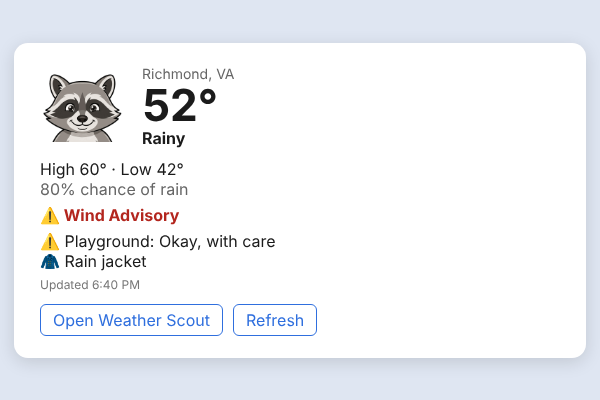

# Phone and desktop apps

Weather Scout is a web app, so every device already gets the full app at your https
address. This page covers the two "real app" options: an **Android app** you can install
from an APK, and a **Windows 11 widget** on the Widgets board. Both open your own server,
so there is nothing else to host and every new Weather Scout feature shows up in them on
its own.

Both need Weather Scout on **https** (see "HTTPS" in the README). GPS, alerts and the app
link all depend on it.

## Android app

The Android app is a [Trusted Web Activity](https://developer.chrome.com/docs/android/trusted-web-activity):
a tiny app (`android/`) that opens your Weather Scout address full screen in Chrome. Because
it is really Chrome, "Use my location", severe weather push alerts and sign-in all work the
same as on the web, and the app never needs an update when the server does. GitHub Actions
builds the APK for you.

### One-time setup

1. **Make a signing key** on any computer with Java:

   ```bash
   scripts/android-keystore.sh weather-scout.jks
   ```

   It prints the secrets and the server setting to use. Keep `weather-scout.jks` and the
   password safe and **outside the repository** (`*.jks` is git-ignored). If you lose it,
   everyone has to uninstall and reinstall the app.

2. **Add GitHub Actions secrets** (repository *Settings → Secrets and variables → Actions →
   Secrets*):

   | Secret | Value |
   | --- | --- |
   | `ANDROID_KEYSTORE_BASE64` | `base64 -w0 weather-scout.jks` (on macOS: `base64 -i weather-scout.jks`) |
   | `ANDROID_KEYSTORE_PASSWORD` | the password you chose |
   | `ANDROID_KEY_ALIAS` | `weather-scout` |
   | `ANDROID_KEY_PASSWORD` | only if the key has its own password (the script uses the same one) |

3. **Add a repository variable** (same page, *Variables* tab):

   | Variable | Value |
   | --- | --- |
   | `WEATHER_SCOUT_URL` | your https address, for example `https://weather.example.com` |
   | `ANDROID_APP_NAME` | optional launcher name (default "Weather Scout") |
   | `ANDROID_PACKAGE_NAME` | optional package id (default `app.weatherscout.android`) |

4. **Link the app to your server** so Android shows it full screen with no browser bar. In
   Unraid (*Edit container → Add another variable*) or `.env`, set:

   ```
   ANDROID_CERT_SHA256=AB:CD:...   # printed by the script, and in every build's summary
   # ANDROID_PACKAGE_NAME=...      # only if you changed it in step 3
   ```

   Restart the container and check `https://<your address>/.well-known/assetlinks.json`
   shows your fingerprint.

### Build and install

- **Any time:** *Actions → Android app → Run workflow*. Leave the address blank to use
  `WEATHER_SCOUT_URL`, or type another one. The APK is under the run's *Artifacts*.
- **With a release:** publish a GitHub release (for example `v0.3.0`) and the workflow
  attaches `weather-scout-0.3.0.apk` to it. Until the setup above is done, releases skip the
  APK with a notice instead of failing.

On the phone, download the APK, open it and allow "Install unknown apps" for your browser or
Files app when Android asks. Updates install over the old version as long as they are signed
with the same key.

Without the signing secrets the workflow still builds a `-debug.apk` with a throwaway key so
you can try it, but each build has a different key, so it won't update in place and the
browser bar stays visible.

**If you see a browser bar at the top** of the app, Android couldn't confirm the link:
check that `ANDROID_CERT_SHA256` matches the fingerprint in the build summary, that the
package names match, and that `/.well-known/assetlinks.json` is reachable from the phone
(it is public on purpose; it only lists the app's id). Android checks again after you
reinstall or clear Chrome's data.

**Alerts on the phone:** open the app, go to *Family & settings → Alerts* and turn them on,
just like on the web. The app asks for Android's notification permission the first time.

**Building it yourself:** with Android Studio or the Android SDK and Java 17,
`cd android && ./gradlew assembleDebug -PwsUrl=https://weather.example.com`. See the
comments at the top of `android/app/build.gradle` for every option.

## Windows 11 widget

Weather Scout's web app manifest defines a **Today** widget for the Windows 11 Widgets board
(press **Win + W**): Rocky, the temperature, high and low, rain chance, the top NWS alert,
the playground rating and what to wear, with *Open Weather Scout* and *Refresh* buttons.
The service worker keeps it fresh about every 15 minutes while Windows lets it.



Windows only shows web app widgets for apps installed as a **Windows app package**, not for a
site you installed from Edge's menu. [PWABuilder](https://www.pwabuilder.com) makes that
package for free from your address:

1. Make sure your Weather Scout https address is **reachable from the internet** while you
   do this (PWABuilder reads the manifest from its own servers). A reverse proxy with a
   public hostname or a Cloudflare Tunnel works. For Tailscale, `tailscale funnel 8080`
   briefly, then turn it off.
2. On pwabuilder.com, enter the address and choose **Package for stores → Windows →
   Generate package** and pick the *test package* (sideload) option.
3. Unzip it on the Windows 11 PC and run `install.ps1` from the folder (right-click → *Run
   with PowerShell*). Windows may ask you to turn on *Developer Mode* (Settings → System →
   For developers) for sideloaded apps.
4. Open Weather Scout once from the Start menu (and sign in if your server requires it),
   then press **Win + W → +** (*Add widgets*) and pick **Weather Scout today**.

The widget uses the same sign-in as the app: if the server has `AUTH_REQUIRED=true`, it
shows "Open Weather Scout and sign in" until you do. Its data comes from
`/api/widget/summary`, which uses the server's home location (`DEFAULT_LAT`/`DEFAULT_LON`).
The card layout is the Adaptive Card in `web/public/widgets/today.json` if you want to change
it; the package doesn't need rebuilding for layout or data changes.

**No widget, just a window?** Any Windows PC can also install Weather Scout from Edge or
Chrome (address bar → *Install*), pin it to the taskbar and get alerts as Windows
notifications.
